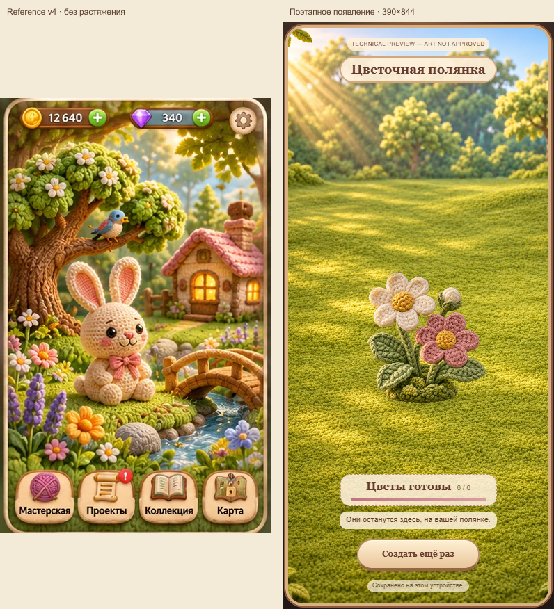

# Шесть этапов волшебного появления

Направление предложено владельцем после отказа от помпона. Команда реализовала и сравнила два варианта, вернула первый за конкретные дефекты процесса и исправила их. Выбран **sparks: прозрачность следующей части и небольшие тёплые огоньки по её контуру**. Готовые части неподвижны и непрозрачны.

Runtime отбора: `4f3db4b5b10785e8d20c9070992529a76b66f410`. Сборка и независимые проверки доставки: `16d44b85cf6c4dd139d19f5b8dad7a09c216799c`. После них меняются только отчёты и выбранные доказательства.

## Что можно проверить

Пустая полянка заполняется одним изделием из шести частей: зелень, сердцевина ромашки, её цельный венчик, розовая сердцевина, её цельный венчик, бутон. Нажатие приближает появление; авто включается явно, продолжает ту же работу и допускает ручную помощь. Большие части занимают примерно 13 нажатий, сердцевины — 4, бутон — 6. Остаток нажатия переносится в следующую часть. Весь чисто ручной цикл — 52 нажатия, полностью автоматический — 144,2 секунды. Это пробный темп одного изделия.

Полянка сохраняется при возвращении; работа авто за время отсутствия учитывается однократно. Завершённый цветок остаётся на месте. Новый проход доступен после завершения.

## Внутренний отбор

| Проверка | Результат и предел вывода |
|---|---|
| [Preflight критика](PREFLIGHT.md) | PROTOTYPE-WORTHY: проверить конкретный процесс, без гарантии удовольствия. |
| [Арт-аудит источников](ART-DIRECTION.md) | Отказ от crossfade целых старых кадров: он менял бы уже сделанные стебли и мох. Выбраны стабильный источник и цельные венчики. |
| [Арт V1](ART-REVIEW.md), [критик V1](CRITIC-V1.md) | RETURN: общая `p^.25` слишком рано показывала почти готовую часть, маленькие сердцевины занимали слишком много кликов. Огоньки выбраны вместо выбеливающей волны. Отрицательные доказательства сохранены. |
| [Критик V2](CRITIC-V2.md) | OWNER-TEST-WORTHY после собственного 52-click цикла и просмотра записанного движения. Две причины RETURN устранены; удовольствие владельца не измерено. |
| [Арт V2](ART-REVIEW-V2.md) | Узкий художественный gate пройден: первый отклик сохранён, венчик различимо проявляется, новых дефектов материала/маски/масштаба не найдено. Полная игровая сцена по-прежнему композиционно проще референса. |
| [Технический review](TECHNICAL-REVIEW.md) | TECHNICAL PASS локального кандидата: модель, отказы сохранения, QA и точные байты сборки проверены независимо. Обнаруженный риск сетевого deadline исправлен. Внешняя доставка подтверждается отдельно. |

## Проверки и доказательства

- 47 репозиторных тестов и 7 регрессий новой модели прошли. Валидация: 0 ошибок, 9 прежних предупреждений о draft-арте кролика.
- Настоящие UI-нажатия на готовом bundle: начало, авто/пауза, уход/возврат, сохранение, завершение, повтор. Размеры [360×800](evidence/qa-v2-360/report.json), [390×844](evidence/qa-v2-390/report.json), [430×932](evidence/qa-v2-430/report.json). В 390 дополнительно touch, клавиатура, reduced motion. Это автоматический браузер, не физический телефон.
- [Независимое видео критика](evidence/critic-v2/process.webm), [его события](evidence/critic-v2/observations.json), [четверти венчика](evidence/critic-v2/corolla-quarters.png), [запись директора](evidence/director-v2-sparks/process.webm). Журналы описывают все снятые кадры; в Git отобрана часть PNG. Видео и исходные журналы не переписываются под итоговый вывод.
- Десять файлов сборки, 1 246 216 байт. [Manifest](../../../stage-study/manifest.json), SHA-256 manifest: `af99db037779d78f97aec524d558b4d181376701f1d973da0e10fee2caa8d084`. Растровые ассеты скопированы без изменения.
- [Перечень выбранных доказательств с SHA-256](EVIDENCE.json) рассчитан по опубликованным Git blobs; текст учитывается в LF, исходные кадры/видео сохранены. Контактные листы и извлечение кадров обозначены в соответствующих обзорах.

Доставка фиксируется в [PR #38](https://github.com/apazidi/mir-na-nitke/pull/38) и [текущей записи P0 #32](https://github.com/apazidi/mir-na-nitke/issues/32): required CI, точные байты по внешнему HTTPS с GitHub-hosted runner и браузерный прогон публичного адреса. Наличие локальной сборки или этого отчёта само по себе не подтверждает публикацию.

## Сравнение с референсом

Обе области сравнения имеют размер 390×844. Референс вписан без растяжения, поэтому имеет поля; справа настоящий финальный экран пробы. Сохраняются объём пряжи, тёплый свет и спокойный масштаб вещи. Количество объектов на законченной референсной сцене не приравнивается к намеренно пустому полю с одним проектом. Этот опыт не завершает композицию полной игры и не меняет утверждённый эталон.

## Границы и следующий продуктовый шаг

Это отдельное техническое превью с noindex, видимой маркировкой и собственным сохранением. Одобрение арта всей игры, экономика нескольких полянок и удовольствие человека здесь не объявляются достигнутыми. Прежние игровые маршруты не заменены.

Следующий содержательный шаг — проверить с владельцем, приятно ли повторное нажатие и хочется ли сделать следующую вещь. Только после этого переносить выбранное появление в основной цикл с несколькими изделиями. Если приятнее лишь ждать авто или смотреть финал, проблема изготовления остаётся открытой.

[Участие владельца и агентов](ACTIVITY.md) отдельно фиксирует происхождение идеи, ошибки, замечания и ответственность за решения.
